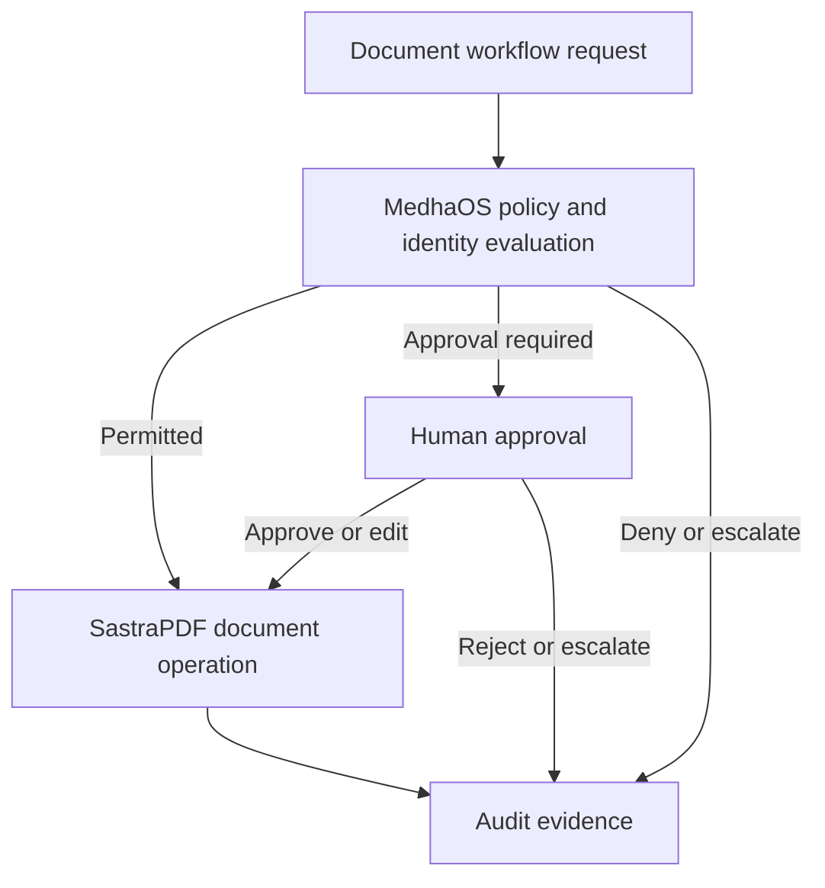

# Governance with MedhaOS

MedhaOS provides governance and control boundaries for enterprise AI workflows. In SastraPDF workflows, MedhaOS can govern identity, roles, policies, approvals, model/provider boundaries, auditability and controlled execution.

## Governance Responsibilities

| Responsibility | Owner |
| --- | --- |
| Document ingestion, editing, extraction and workflow execution | SastraPDF |
| Reasoning, retrieval and recommendations | Medha |
| Identity, RBAC, tenant isolation, policies and approvals | MedhaOS |
| Records and business transactions | Connected enterprise systems |

## Conceptual Control Flow

## Conservative Boundary

MedhaOS governance is intended to support accountable workflows, but this documentation does not claim automatic compliance, completed regulated-environment deployment or production validation.

See the [MedhaOS public documentation](https://github.com/sastra-innovations/medha-os-public-docs) for product-specific governance documentation.
