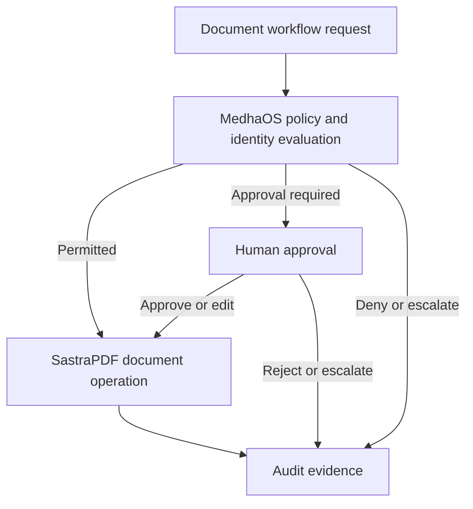

# Governance with MedhaOS

MedhaOS provides the governance and control envelope for enterprise AI workflows. In SastraPDF workflows it admits, limits, revokes, recovers and governs controlled execution. It consumes current identity, membership, tenancy, action-access, policy, privacy, security, audit and entitlement evidence from the named services rather than becoming their second owner.

## Governance Responsibilities

| Responsibility | Owner |
| --- | --- |
| Document ingestion, editing, extraction and workflow execution | Documents and the other named document-effect services, composed through SastraPDF |
| Reasoning, retrieval and recommendations | Medha |
| Intelligence admission, model/provider controls and controlled execution | MedhaOS |
| Principal/session assurance, membership, placement, action permission, policy, approval disposition and audit proof | Identity, Accounts, Tenancy, Action Access, Policy, Decision and Audit respectively |
| Records and business transactions | Connected enterprise systems |

## Conceptual Control Flow

## Conservative Boundary

MedhaOS governance is intended to support accountable workflows, but this documentation does not claim automatic compliance, completed regulated-environment deployment or production validation.

See the [MedhaOS public documentation](https://github.com/sastra-innovations/medha-os-public-docs) for product-specific governance documentation.
