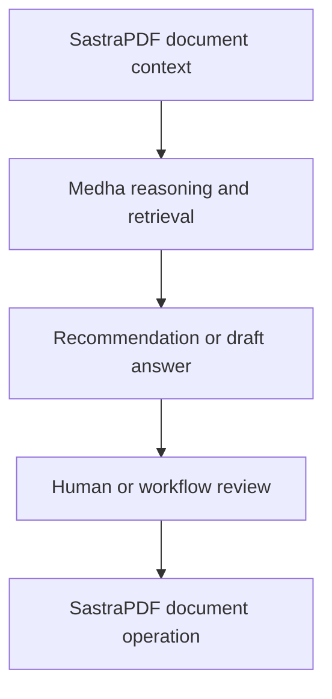

# Medha Integration

Medha is Sastra Innovations' proprietary multi-model reasoning and orchestration engine. In SastraPDF workflows, Medha may reason over permitted document context, support retrieval and recommend next steps.

## Integration Roles

| Product | Role |
| --- | --- |
| SastraPDF | Owns document operations, collaborative editing and document workflow execution. |
| Medha | Owns reasoning, retrieval, context, model selection and intelligent recommendations. |
| MedhaOS | Owns identity, RBAC, tenant isolation, policies, model/provider boundaries, approvals and controlled execution. |

## Conceptual Flow

## Future Integration Status

Medha reasoning over SastraPDF document workflows is documented as `Beta preparation`. This is a future integration direction and should not be read as a generally available SastraPDF private-alpha capability.

See the [Medha public documentation](https://github.com/sastra-innovations/medha-public-docs) for product-specific Medha positioning.
