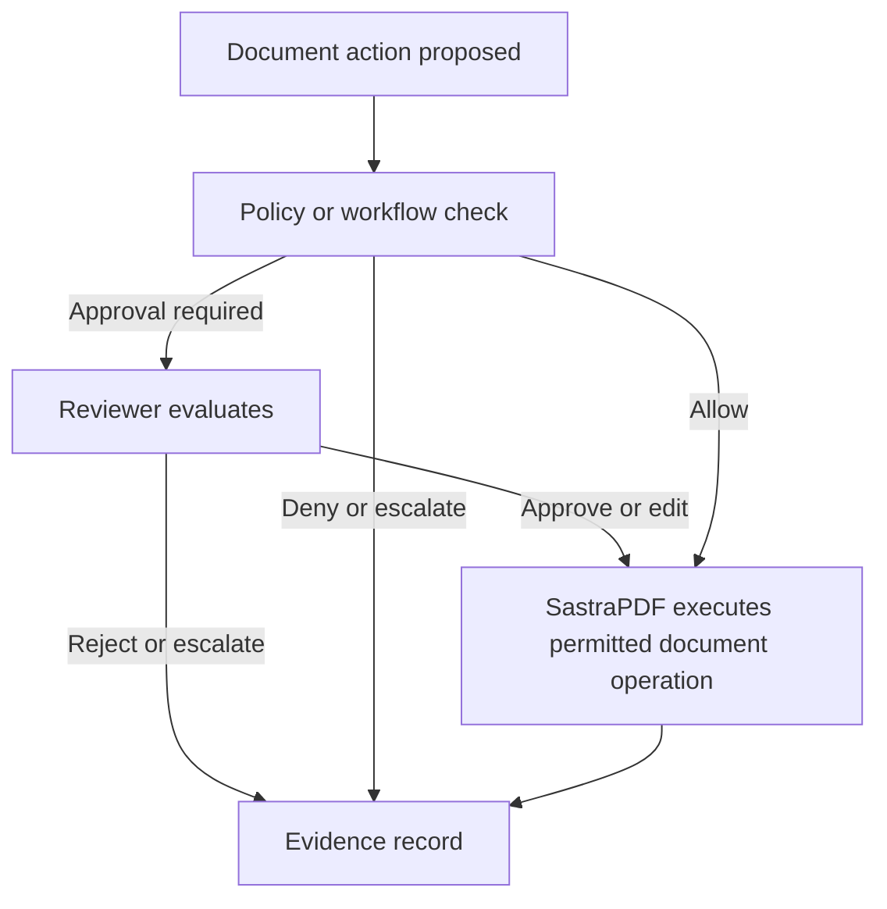

# Approvals and Accountability

Approval and accountability patterns help organizations control sensitive document actions such as publishing, signing, redaction, external sharing and workflow execution.

## Verified and Conservative Capabilities

| Capability | Status | Notes |
| --- | --- | --- |
| Reviewer assignment | Implemented; validation pending | Assigns accountable reviewers. |
| Signature workflow evidence | Implemented; validation pending | Supports signing evidence and audit export. |
| Audit evidence | Implemented; validation pending | Captures review or workflow evidence where enabled. |

## Future Integration Direction

| Capability | Status | Notes |
| --- | --- | --- |
| Approval-controlled document action | Beta preparation | Intended to use MedhaOS policy and approval boundaries when integrated. |
| Human approval for AI-assisted actions | Beta preparation | Intended to apply human review to sensitive AI-assisted workflow steps. |

## Conceptual Approval Flow

## Boundary

Medha may propose an action. MedhaOS evaluates identity, role, tenant, policy and approval requirements. SastraPDF executes the document operation only when permitted.
