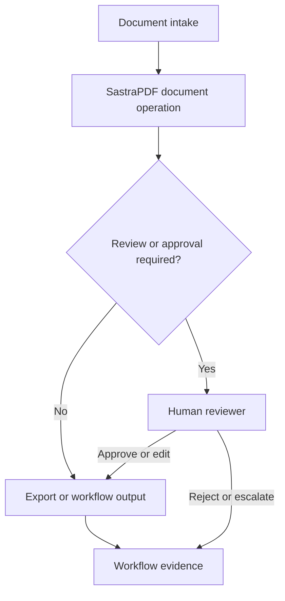

# Workflow Automation

SastraPDF can participate in document-heavy enterprise workflows for intake, review, extraction, transformation, approval and export. Workflow automation is positioned conservatively as controlled document workflow execution, not unrestricted autonomous action.

## Conceptual Flow

## Verified Capabilities

| Capability | Status | Notes |
| --- | --- | --- |
| Workflow pipelines | Implemented; validation pending | Coordinates repeatable document processing. |
| Batch conversion | Implemented; validation pending | Runs conversion across multiple files. |
| Form publishing | Implemented; validation pending | Prepares forms under workflow controls. |
| Form submission review | Implemented; validation pending | Handles review of received submissions. |
| Approval-controlled document action | Beta preparation | Requires MedhaOS policy and approval boundaries when integrated. |
| Signature certificate and audit export | Implemented; validation pending | Provides evidence for signing workflows. |

## Product Boundary

SastraPDF presents and coordinates document workflow operations. Medha may recommend or reason about next steps. MedhaOS governs controlled execution, while Identity, Action Access, Policy and Decision retain assurance, may-act, policy and approval-disposition effects. A rejected or escalated action should not proceed to execution.
